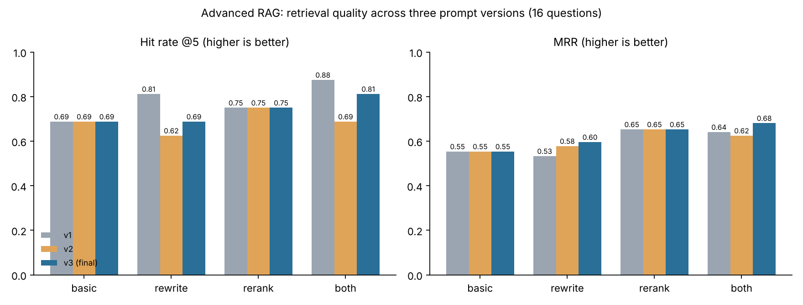

# Advanced RAG: Query Rewriting and Reranking

A small, fully local and free RAG (Retrieval-Augmented Generation) project that compares **basic retrieval** with retrieval improved by **LLM query rewriting** and **cross-encoder reranking**, tested on public cyber-security documents.

Medium article: _add your link here_

## What it does
| Mode | Pipeline |
|---|---|
| basic | embed question, FAISS top-5 |
| rewrite | LLM rewrites the query, then FAISS top-5 |
| rerank | FAISS top-20, cross-encoder keeps best 5 |
| both | rewrite, FAISS top-20, rerank, keep 5 |

## Tech stack
Python, pypdf, sentence-transformers (`all-MiniLM-L6-v2`), FAISS, cross-encoder (`ms-marco-MiniLM-L-6-v2`), Ollama (`llama3.2:3b`), Streamlit, Pandas, Matplotlib.

## Setup
1. Install [Ollama](https://ollama.com) and run `ollama pull llama3.2:3b`
2. `pip install -r requirements.txt`
3. Download the public PDFs listed in `DOCUMENT_SOURCES.md` into a `docs/` folder
4. `python ingest.py`

## Run
- Web app: `streamlit run app.py` (tick "Compare basic vs enhanced")
- Evaluation: `python evaluate.py` (add `--answers` to also generate answers)

## Results (16 test questions: 6 clear, 8 vague, 2 ambiguous)
Hit rate @5 / MRR. Three versions of the rewrite step were tested:
- **v1:** long, keyword-rich rewrite
- **v2:** short, strict rewrite that keeps the user's words
- **v3 (final):** original question + short rewrite searched together

| Mode | v1 | v2 | v3 (final) |
|---|---|---|---|
| basic | 0.688 / 0.554 | 0.688 / 0.554 | 0.688 / 0.554 |
| rewrite | 0.812 / 0.533 | 0.625 / 0.578 | 0.688 / 0.596 |
| rerank | 0.750 / 0.653 | 0.750 / 0.653 | 0.750 / 0.653 |
| both | 0.875 / 0.641 | 0.688 / 0.625 | 0.812 / 0.681 |

Average retrieval time: basic about 0.1 s, both about 1.9 s.

## Limitations
- Only 16 questions; one question equals about 6 percentage points, so results are indicative, not conclusive.
- The prompt was tuned on the same questions used to test it, so some overfitting is possible.
- "Hit" is a keyword match on the retrieved chunk and can be a false positive.
- Very ambiguous questions (no topic given) are not rescued by rewriting.
- The small 3B model sometimes answers "I could not find this" even when the right chunk was retrieved.

## Project files
`rag.py` pipeline, `ingest.py` index builder, `evaluate.py` evaluation, `app.py` Streamlit UI, `config.py` settings, `eval/questions.json` test questions, `results/` saved result files.
