<div align="center">

# 🔎 Advanced RAG: Query Rewriting + Reranking

**Does an LLM rewrite step and a cross-encoder reranker really improve retrieval? A fully local, free experiment on public cyber-security documents.**


[📖 Medium article](https://medium.com/@reddymanojkumar1518/advanced-rag-in-practice-does-query-rewriting-and-reranking-really-help-1f6f5114eb99) · [🧪 Results](#-results) · [🏗️ Architecture](#%EF%B8%8F-architecture) · [🖼️ Screenshots](#%EF%B8%8F-screenshots)

</div>

---

## 📌 Overview

A basic RAG (Retrieval-Augmented Generation) app searches documents with the user's question exactly as typed. Vague questions such as *"how do they stop it?"* often retrieve the wrong passages.

This project builds **four retrieval modes** and measures them on the same 16 questions:

| Mode | Pipeline |
|---|---|
| 🟦 **basic** | embed question → FAISS top-5 |
| ✏️ **rewrite** | LLM rewrites the query → FAISS top-5 |
| 📊 **rerank** | FAISS top-20 → cross-encoder keeps best 5 |
| 🚀 **both** | rewrite → FAISS top-20 → rerank → best 5 |

## ✨ Key findings

- ✅ **Combined rewrite + rerank retrieved the right passage in 13 of 16 questions** (basic: 11 of 16).
- 📈 **Best ranking quality:** MRR 0.681 versus 0.554 for basic.
- 🎯 **Clear questions: 6 of 6** with the final configuration.
- 🧪 **A "smarter" prompt made things worse first.** A strict rewrite prompt (v2) dropped hit rate from 0.875 to 0.688. Searching with the *original question plus the rewrite together* (v3) recovered most of it.
- ⏱️ **Cost:** about **20× slower retrieval** (0.09 s → 1.95 s), mostly from the extra LLM call.
- ⚠️ **Ambiguous questions still fail** (0 of 2): rewriting cannot invent a topic the user never gave.

## 🏗️ Architecture

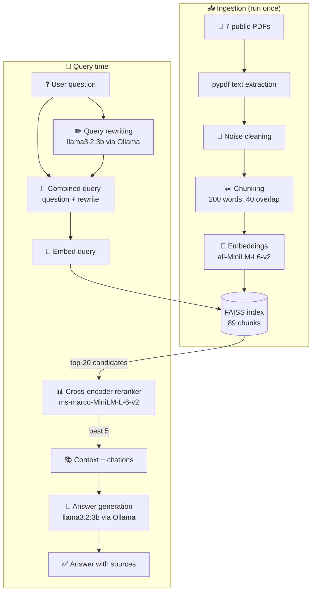

## 🧰 Tech stack

| Component | Tool |
|---|---|
| Language | Python |
| PDF reading | pypdf |
| Embeddings | sentence-transformers `all-MiniLM-L6-v2` |
| Vector search | FAISS |
| Reranker | cross-encoder `ms-marco-MiniLM-L-6-v2` |
| LLM (rewriting and answers) | Ollama `llama3.2:3b` (local) |
| Interface | Streamlit |
| Evaluation | Pandas |

## 🚀 Quick start

```bash
# 1. Install Ollama (https://ollama.com), then:
ollama pull llama3.2:3b

# 2. Install Python libraries
pip install -r requirements.txt

# 3. Download the public PDFs listed in DOCUMENT_SOURCES.md into docs/

# 4. Build the index
python ingest.py

# 5. Run the app
streamlit run app.py
```

Run the evaluation:

```bash
python evaluate.py            # retrieval metrics (fast)
python evaluate.py --answers  # also generate answers for manual scoring
```

## 🧪 Results

**Test set:** 16 questions: 6 clear, 8 vague, 2 ambiguous. A retrieval "hit" means a chunk containing the expected phrase appears in the top 5.

Three versions of the rewrite step were tested:

| Version | Rewrite strategy |
|---|---|
| **v1** | Long, keyword-rich rewrite |
| **v2** | Short, strict rewrite that keeps the user's words |
| **v3 (final)** | Original question **+** short rewrite, searched together |

**Hit rate @5 / MRR**

| Mode | v1 | v2 | v3 (final) |
|---|---|---|---|
| basic | 0.688 / 0.554 | 0.688 / 0.554 | 0.688 / 0.554 |
| rewrite | 0.812 / 0.533 | 0.625 / 0.578 | 0.688 / 0.596 |
| rerank | 0.750 / 0.653 | 0.750 / 0.653 | 0.750 / 0.653 |
| **both** | **0.875** / 0.641 | 0.688 / 0.625 | 0.812 / **0.681** |

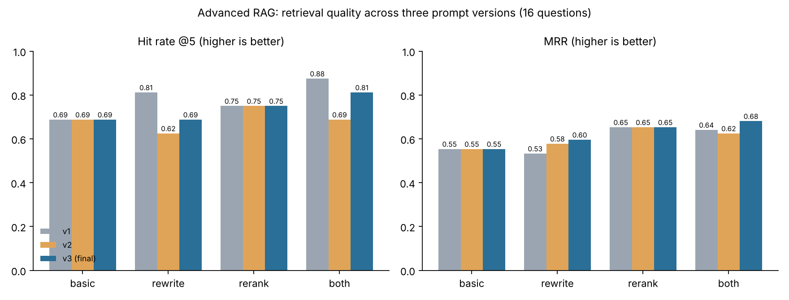

**Hit rate by question type (v3)**

| Mode | Clear | Vague | Ambiguous |
|---|---|---|---|
| basic | 0.83 | 0.63 | 0.5 |
| rerank | 0.83 | 0.75 | 0.5 |
| rewrite | 0.83 | 0.75 | 0.0 |
| **both** | **1.00** | **0.88** | 0.0 |

**Latency (average retrieval time):** basic ≈ 0.09 s · rewrite ≈ 1.5 s · rerank ≈ 1.1 s · both ≈ 1.95 s

## 🖼️ Screenshots

### Application

| Home | Retrieval modes |
|:---:|:---:|
| 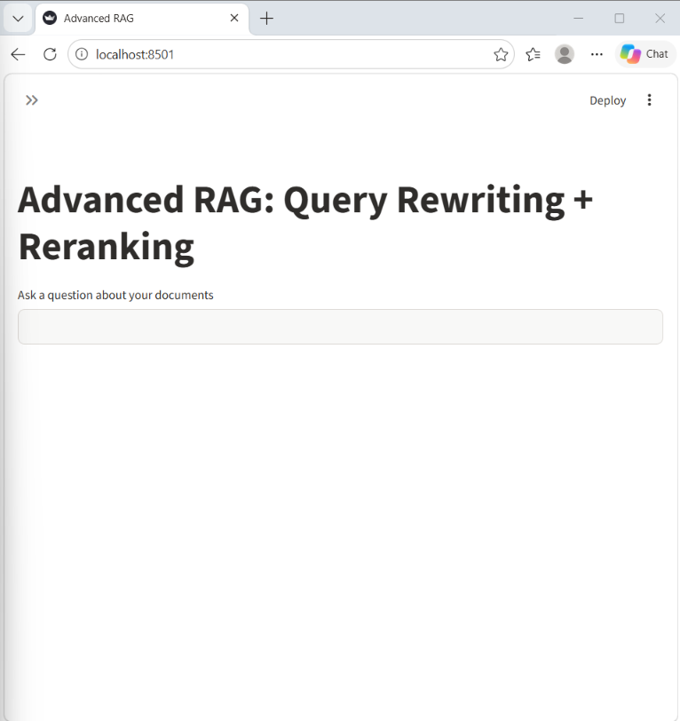 | 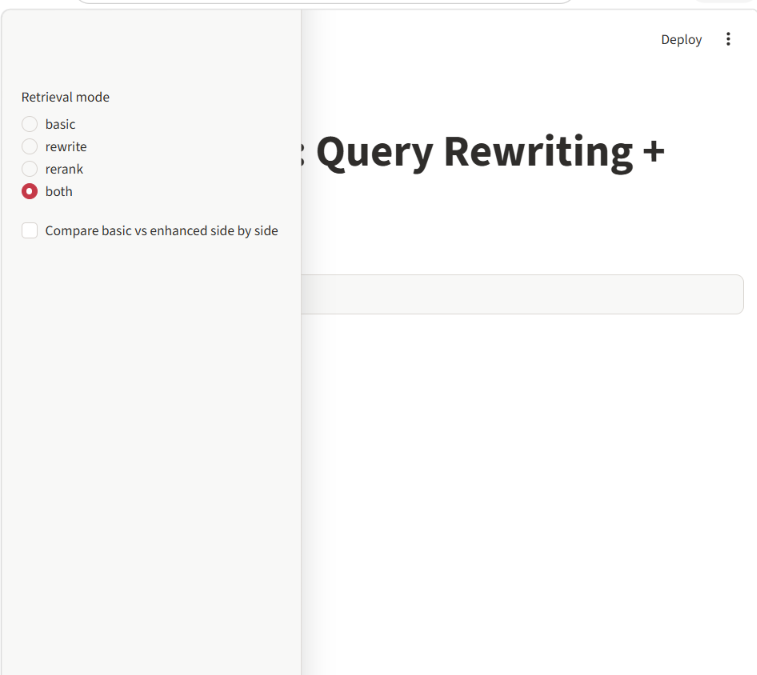 |

### Basic vs enhanced: a clear question

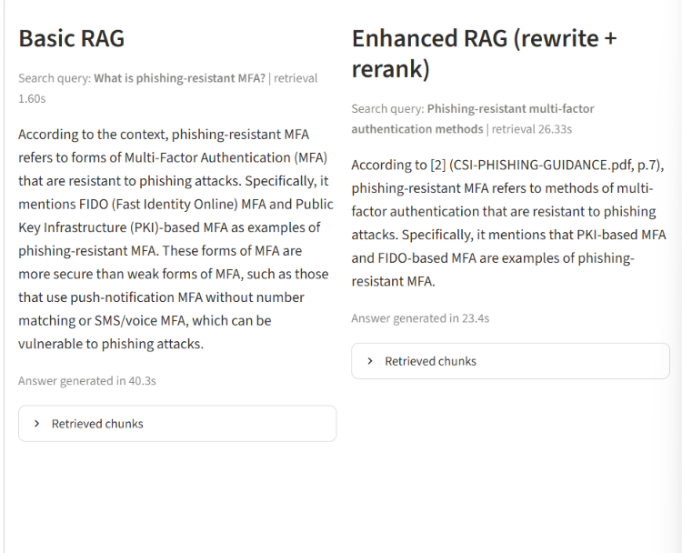

### Basic vs enhanced: a very ambiguous question

For *"how do they stop it?"* the rewrite became the generic *"Preventing a cyber attack"*, and enhanced mode answered *"I could not find this."* This is a real limitation: a rewriter cannot recover a topic the user never gave.

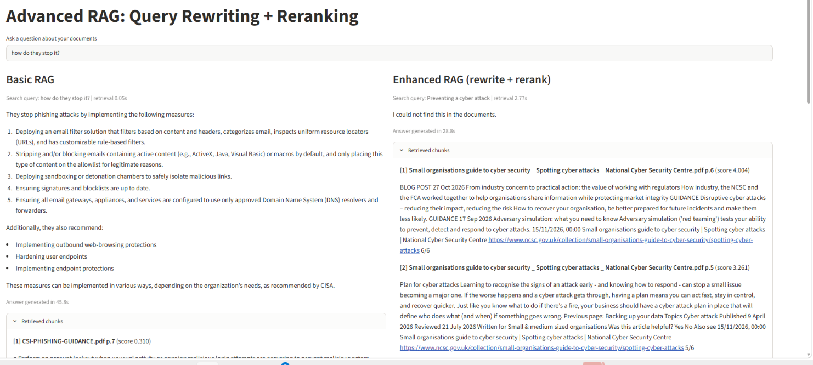

### Retrieved chunks and scores

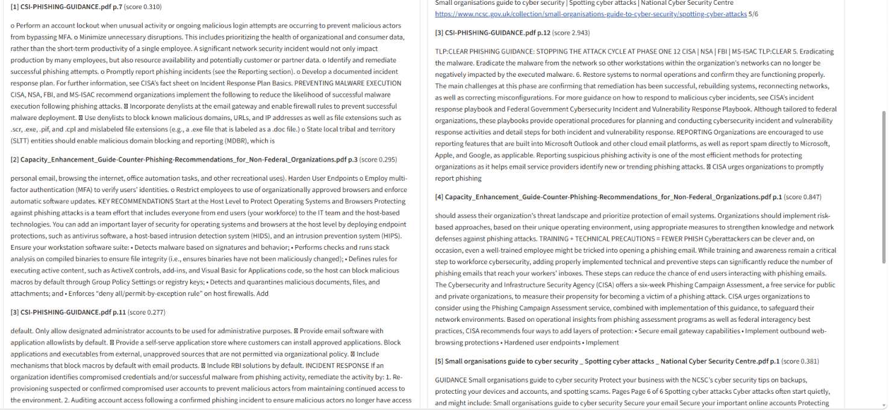

### More examples

> The two screenshots below were taken with the **v1** rewrite prompt, before the final v3 change.

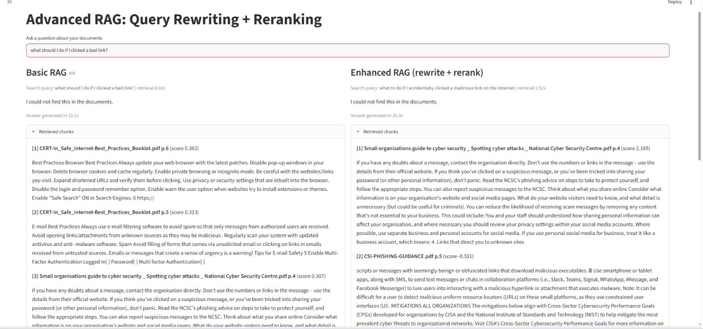

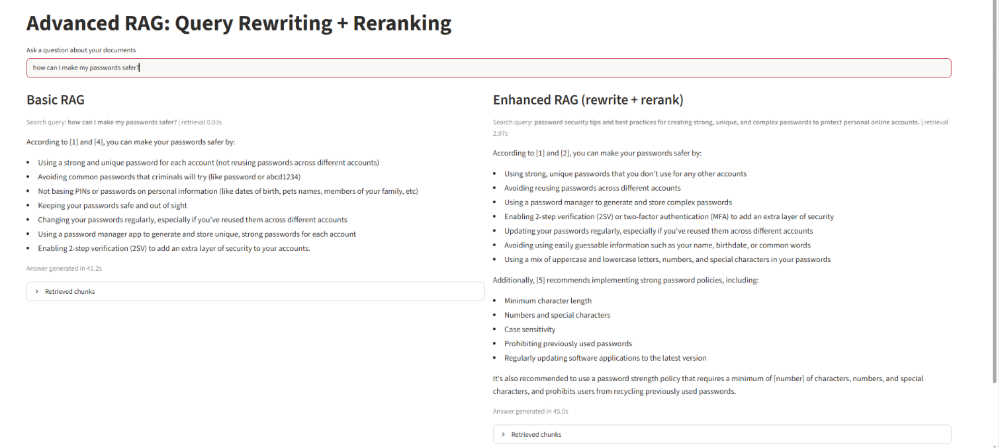

### Evaluation output

| v1 run | v3 run (final) |
|:---:|:---:|
| 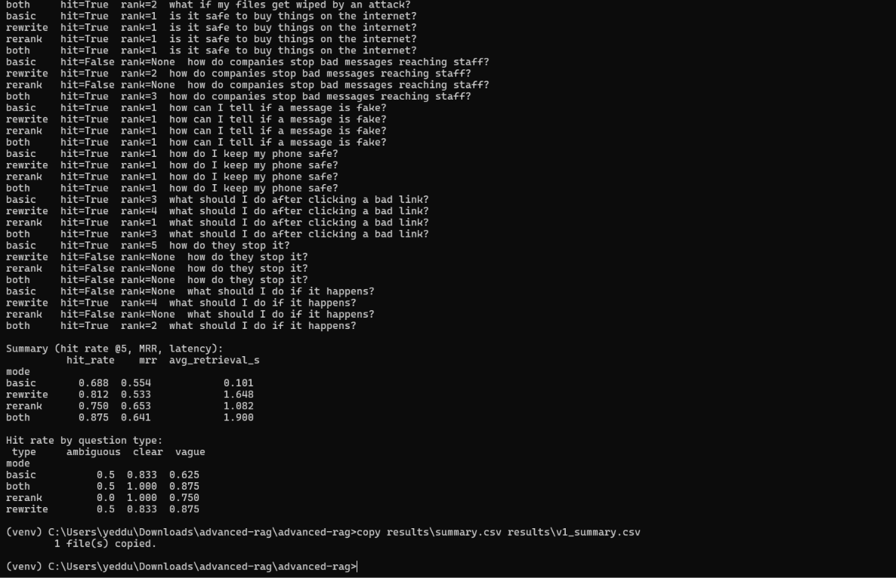 | 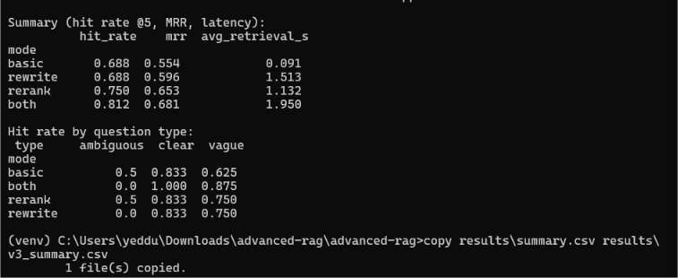 |

## ⚠️ Limitations

- **Small test set.** 16 questions; one question is about 6 percentage points, so the results suggest rather than prove.
- **Possible overfitting.** The rewrite prompt was tuned on the same 16 questions used to test it.
- **Loose "hit" check.** A keyword match can be a false positive without the chunk really answering the question.
- **Retrieval is not answer quality.** In several cases the right chunk was retrieved but the small 3B model still answered "I could not find this."
- **Noisy source text.** Web pages saved as PDF contain navigation text, which also affected retrieval.
- **Ambiguous questions** are not rescued by rewriting.

## 🔮 Future work

- A larger, held-out test set and LLM-assisted answer scoring
- A hybrid search (BM25 + vectors)
- A larger local model or a hosted LLM for answer generation
- Better PDF cleaning and structure-aware chunking

## 📁 Project structure

```
├── app.py                 # Streamlit UI (basic vs enhanced side by side)
├── rag.py                 # Core pipeline: ingestion, rewriting, reranking, answering
├── ingest.py              # Builds the FAISS index
├── evaluate.py            # Runs all 4 modes on the test questions
├── config.py              # Models, chunk size, top-k settings
├── eval/questions.json    # 16 test questions
├── results/               # Saved results for v1, v2, v3
├── screenshots/           # Application and evaluation screenshots
├── DOCUMENT_SOURCES.md    # Links to the public PDFs used
└── results_chart.png
```

## 📚 Documents used

All from public, official sources. See [`DOCUMENT_SOURCES.md`](DOCUMENT_SOURCES.md): CISA/NSA/FBI/MS-ISAC phishing guidance, CISA counter-phishing recommendations, CERT-In safe internet booklet, and the UK NCSC small organisations guide.

## 👤 Author

**manoj-kumar2277** · [GitHub](https://github.com/manoj-kumar2277)

_Built as part of an AI engineering assignment on advanced RAG techniques._
